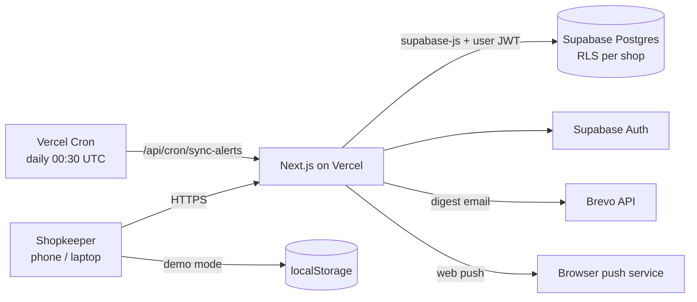

# Expirix — Architecture

Expiry and stock tracking for kirana stores. Next.js 16 (App Router) + Supabase (Postgres, Auth, RLS) + Tailwind 4, deployed on Vercel.

## Key ideas
- **One data interface, two backends.** `lib/repo/` has `supabase.ts` (cloud) and `local.ts` (demo, browser only). The UI never knows which is active.
- **Multi-tenant by RLS.** Every table carries `shop_id`; policies use `current_shop_id()`, so a user can only ever read or write their own shop. A signup trigger creates the shop and profile.
- **Stock is a ledger.** Quantity changes go through `record_movement` (received, sold, damaged, expired, returned, adjustment), so history is auditable.
- **Alerts.** `lib/alerts.ts` plans notifications from batch expiry dates and the shop's thresholds. The daily cron syncs them for every shop.
- **Daily digest.** `lib/digest.ts` (pure) groups items into expired / urgent / soon. The cron sends it by email (Brevo) and web push, at most once per shop per day (`last_digest_on`). The wording lives only in this file.
- **WhatsApp share** reuses the same digest text, opened via `wa.me`.
- **Hindi.** `lib/i18n-*.ts`: strings are keyed by their English text; language is kept in localStorage.
- **PWA.** `app/manifest.ts`, `public/sw.js` (push + click handling), installable on phones.
- **Account control.** JSON backup download, and `delete_my_account()` (security definer) removes the shop and login.

## Layout
| Path | Purpose |
|---|---|
| `app/(app)/` | Dashboard, inventory, alerts, reports, calendar, settings |
| `app/api/cron/sync-alerts` | Daily alert sync and digest delivery |
| `app/api/notify/test` | Sends a test email/push to the signed-in user only |
| `lib/server/` | Server-only helpers (Brevo, web-push, shop loader) |
| `supabase/` | `schema.sql` (fresh install), `update-2026-11.sql` (upgrade) |
